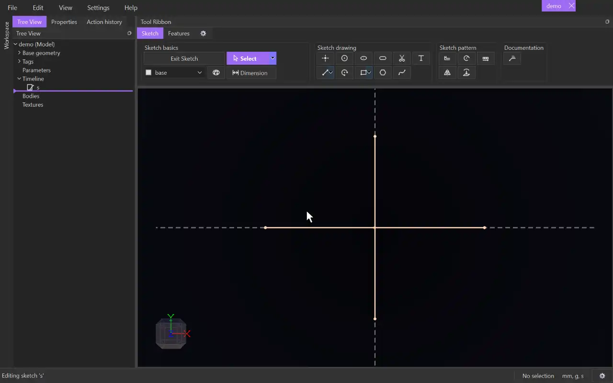

# Trim

{.tool-demo}

Cuts away the piece of a curve between the places where other curves cross it. Click a piece to remove it, or drag across several pieces to remove them all.

**Where:** Sketch tab › Sketch Other · **Shortcut:** X

## How to use
1. Open a sketch and click **Trim**. It only works inside a sketch.
2. Move the cursor over a curve. The piece a click would remove is previewed.
3. Click to remove that piece.
4. Or hold the mouse button and drag. Every curve the cursor passes over is trimmed as it passes. The whole drag is one undo step.
5. Press Escape to return to [Select](select.md).

## Tips
- Works on lines, arcs, circles, splines and polyline segments.
  - A **line** or **arc** is shortened, or split in two if you remove a middle piece.
  - A **circle** becomes the arc that is left.
  - A **polyline** is split into two polylines. A closed one opens.
  - A **spline** keeps its shape. A closed one opens.
- A curve nothing crosses is deleted whole when you trim it. An ellipse can only be trimmed that way. If something crosses an ellipse, trimming it is refused.
- Every curve in the sketch can act as a cutter, including construction, reference and projected geometry.
- Constraints carry over where they still make sense. A new cut end is held on the curve that cut it. A dimension across the removed part is dropped.
- A curve trimmed in place keeps its name, so features that use it keep working.
- If a trim can't be done, the status bar says why.
- Use Ctrl+Z to undo a trim.

## See also
- [Line](line.md) — draw extra lines just to trim against
- [Circle](circle.md) — trim a circle to get an arc that ends exactly at crossings
- [Select](select.md) — delete whole items instead

[← Sketch Other](../bags/sketch_other.md) · [All documentation](../index.md)
