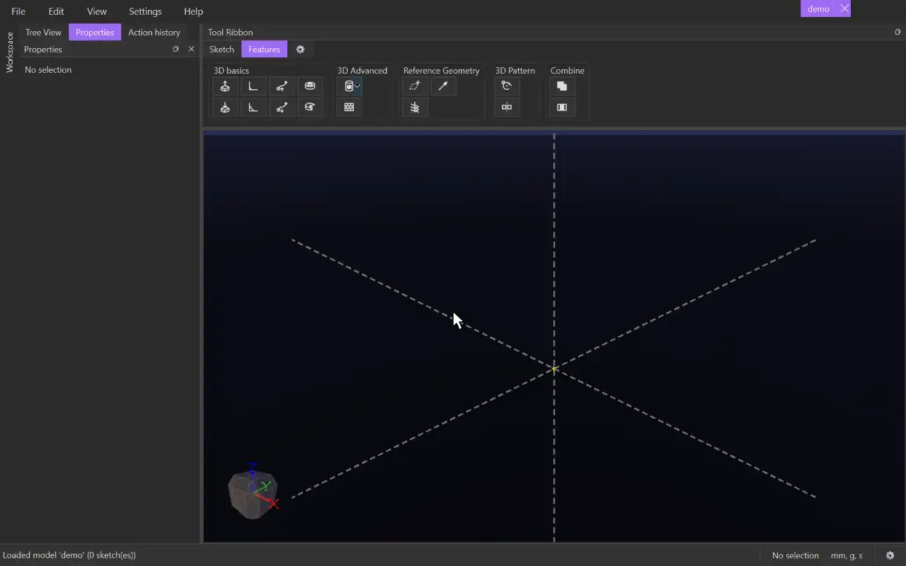

# Vector

{.tool-demo}

Creates a reference vector: a direction and a length, starting at the origin and drawn as a see-through arrow. The vector is also a value you can use in expressions, for example to drive an extrude's distance from its Z component.

**Where:** Features tab › Reference Geometry · **Shortcut:** none

## How to use
1. Optionally select what the vector should point along first.
2. Click **Vector**. The **Direction from** box is active, so click a point, line, edge, face, plane, circle or another vector. Or leave the box empty and type **X**, **Y** and **Z**.
3. Set the **Magnitude**, and use **Flip** if the arrow points the wrong way. The arrow preview updates as you go.
4. Click **Create** (or press Ctrl+Enter). Escape or **Cancel** discards it.

## Options
- **Name** — how expressions refer to it. It defaults to the next free name (Vector1, Vector2, ...).
- **Direction from** — what gives the direction:
  - a point: towards the point
  - a line or edge: along it
  - a face or plane: along its normal
  - a circle, arc or round face: along its axis
  - another vector: the same direction
  - two planes or flat faces: along the line where they meet
  A new pick replaces the old one, unless it pairs with it as a second plane or face.
- **X / Y / Z** — the components, used only when nothing is picked. Plain numbers make a unitless vector; add a unit (e.g. `5mm`) to give it one.
- **Magnitude** — the length along a picked direction. 1 gives a unit vector. When X / Y / Z are typed, this box is greyed out and shows the length they come to.
- **Flip** — reverses a picked direction that has no sign of its own, such as a face normal.
- **Points** — read-only: where the vector points.

## Tips
- Use it in any value box: `Vector1::x`, `Vector1::y`, `Vector1::z` and `Vector1::length`, plus the functions `dot(A, B)`, `angle(A, B)`, `cross_x(A, B)` / `cross_y(A, B)` / `cross_z(A, B)` and `along(A, B)`.
- A vector follows the geometry it was picked from. If that geometry is deleted, the vector shows an error.
- A unitless vector is drawn at a fixed size relative to the model (times its magnitude). A length vector is drawn at its true length. Vectors in other units are not drawn.
- The arrow shows through bodies so it stays visible.
- To change a vector later, including its name, right-click it in the Model tab and choose **Edit Vector**.

## See also
- [Plane](plane.md) — other reference geometry
- [Helix](helix.md) — a reference curve
- [Extrude](extrude.md) — a distance driven by a vector component

[← Reference Geometry](../bags/reference_geometry.md) · [All documentation](../index.md)
