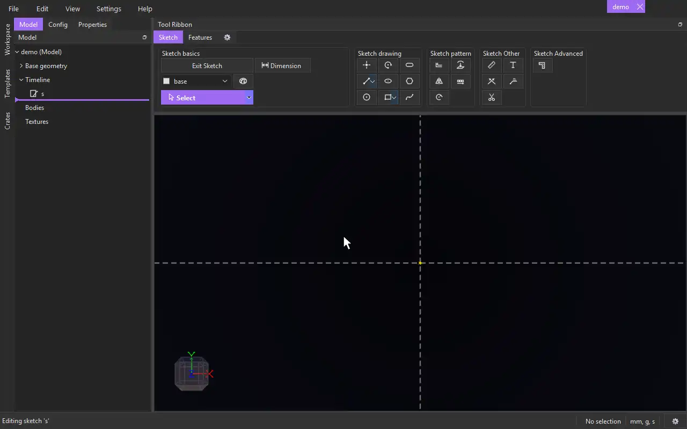

# Wall

{.tool-demo}

Draws a wall: a band of even thickness that follows a centerline, with mitred corners and square ends. Use it for floor plans and anything else built from walls.

**Where:** Sketch tab › Sketch Advanced

## How to use
1. Click **Wall**. If you aren't in a sketch yet, click a plane or flat face first to start one.
2. Click to place the start of the wall's centerline.
3. Click again to set the width. The distance from the start is half the wall's thickness, measured from the centerline to one face, the way a click sets a circle's radius. This click makes no point and no constraint.
4. Click the centerline's corners, as with a polyline. The wall follows as you draw.
5. Press Escape or double-click to finish an open wall. Click the first corner again to close the wall into a loop.

## Options
- The wall's faces go on the tag chosen in the [Tag selector](tag_selector.md). The centerline always goes on **construction**.

## Tips
- The wall stays tied to its centerline. Drag a corner of the centerline and the wall follows, keeping its thickness.
- The wall has one dimension, its width (centerline to face). Double-click its number to change it; an expression or parameter works too.
- Corners are always mitred: the two faces meet where they cross. A closed wall joins cleanly where it closes, with the same thickness all the way round.
- An open wall's ends are cut square across, at the centerline's end points.
- Type a number for the width (step 3) or for a centerline segment's length, as with [Line](line.md): Enter applies it, Enter again places it.
- Deleting the wall, its centerline or one of its faces removes the whole wall.

## See also
- [Line](line.md) — the Polyline variant draws the same kind of centerline on its own
- [Offset](offset.md) — offset copies of lines to one side
- [The Architecture crate](../guides/architecture.md) — floor plans from tagged sketch surfaces

[← Sketch Advanced](../bags/sketch_advanced.md) · [All documentation](../index.md)
