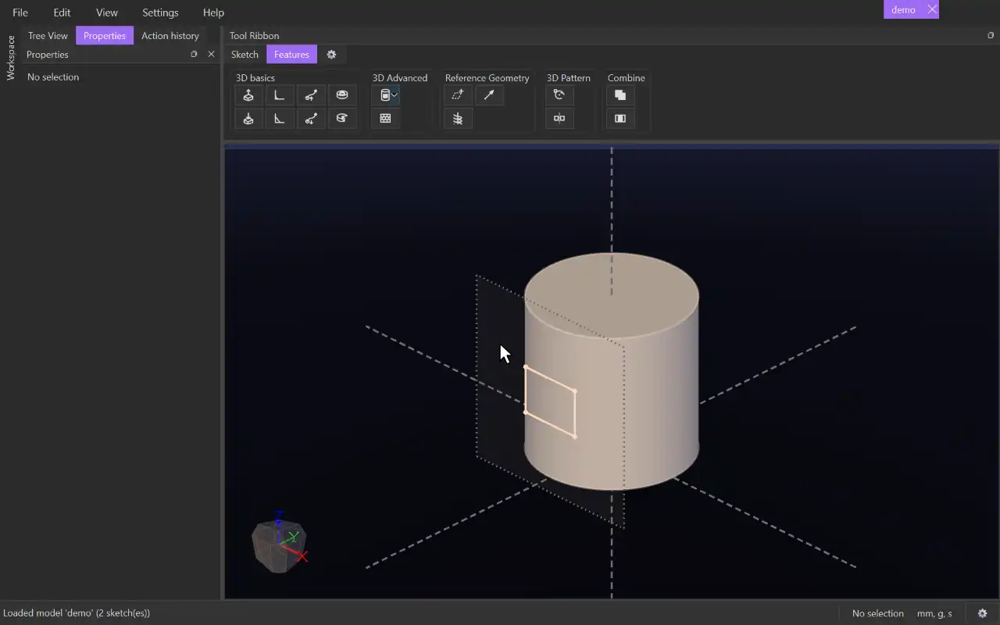

# Wrap

{.tool-demo}

Wraps a sketch's surfaces onto a curved face of a body, then raises them out of the face (emboss) or sinks them into it (engrave). Use it for labels, lettering or patterns on cylinders, cones and other curved faces.

**Where:** Features tab › 3D Advanced · **Shortcut:** none

## How to use
1. Draw the shapes (or text) in a sketch whose plane touches, or sits near, the curved face. A plane made tangent to the face with the [Plane](plane.md) tool works well.
2. Select the sketch (or anything in it), or stay inside the sketch you are editing, and click **Wrap**. If you also selected a curved face first, it is filled in for you.
3. The sketch's surfaces are picked automatically. Click the **Surfaces** box and click surfaces in the view to add or remove them.
4. The form opens on the first empty pick box, usually **Face**. Click the curved face to wrap onto.
5. Choose **Extrude** or **Cut**, set the **Depth**, and watch the live preview.
6. Click **Create** (or press Ctrl+Enter). Escape or **Cancel** leaves without changes.

## Options
- **Mode** — *Extrude* raises the wrapped shape out of the face; *Cut* sinks it into the face.
- **Surfaces** — the sketch surfaces to wrap. A piece of text is always taken whole. Select a row and press Delete to remove it.
- **Face** — the curved face to wrap onto. Each new pick replaces the last one.
- **Depth** — how far the shape stands out (Extrude) or sinks in (Cut). It accepts expressions and parameters.
- **Flip** — pushes along the other side of the face, for example inside a tube. A new cut starts on the side that removes material until you change Flip yourself.
- **Draft** — tick it to lean the walls by the angle you type, in degrees (5 to start with). Positive narrows the walls away from the face; negative widens them.
- **Bodies** — *Cut only.* The bodies the cut removes material from. It starts with the face's own body.

## Tips
- The sketch rolls onto the face from the point where the sketch plane touches it. Distance along the plane becomes distance around the face, and height stays height. If the plane does not touch the face, the nearest point is used.
- Cylinders and cones unroll exactly, so lengths are kept. Other curved faces (spheres, fillets) get the sketch laid out over the surface with as little stretching as possible.
- Shapes may run past the face's edges, or overlap themselves if they go all the way round.
- Flat faces are refused. Use [Extrude](extrude.md) or [Cut Extrude](cut_extrude.md) for those.
- Once used, the sketch is hidden. To change the wrap later, right-click it in the Model tab and choose **Edit Feature**.
- The form reopens with the values you used last time.
- For a faster relief that leaves the body unchanged, use **Texture Wrap** from the Wrap button's drop-down (see [Texture](texture.md)).

## See also
- [Texture](texture.md) — Texture Wrap, and patterns on faces
- [Plane](plane.md) — a plane tangent to a curved face, ready to sketch on
- [Extrude](extrude.md) — the same raise, on flat sketches

[← 3D Advanced](../bags/3d_advanced.md) · [All documentation](../index.md)
